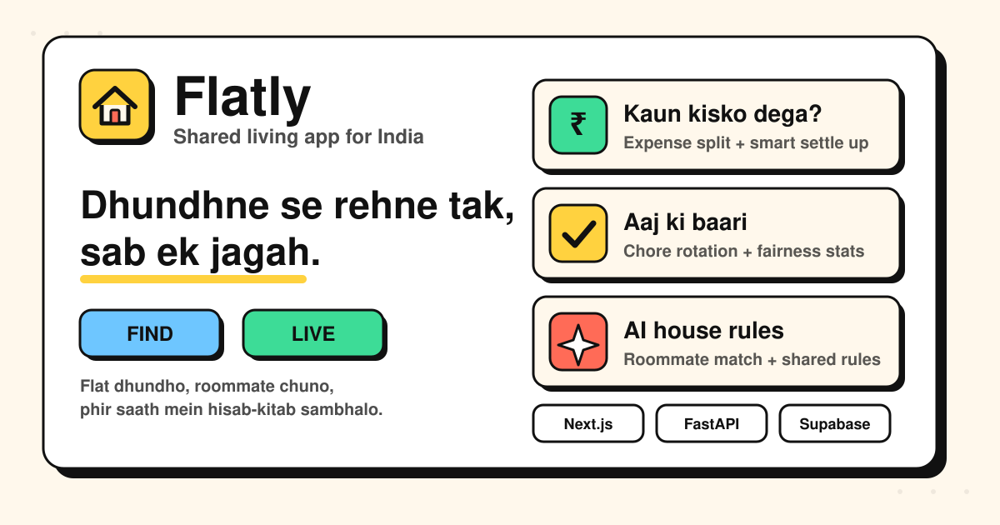

<p align="center">
  
</p>

# Flatly 🏠

**Dhundhne se rehne tak, sab ek jagah.**

Flatly is a mobile-first shared-living app for students and young professionals in India. One app, two modes:

- **Find**: look for a flat or a roommate, or post a vacancy in your own flat.
- **Live**: once you share a flat, manage money, chores and house rules together.

Both modes work on the same flat data, so the flat you find becomes the flat you live in.

**Live demo:** [flatly-teal.vercel.app](https://flatly-teal.vercel.app)

---

## Contents

- [Features](#features)
- [Tech stack](#tech-stack)
- [Project structure](#project-structure)
- [Getting started](#getting-started)
  - [Frontend](#1-frontend-nextjs)
  - [Supabase](#2-supabase-auth)
  - [Backend API](#3-backend-api-fastapi)
- [Environment variables](#environment-variables)
- [API overview](#api-overview)
- [Testing](#testing)
- [Current status](#current-status)
- [Known issues](#known-issues)
- [Roadmap](#roadmap)

---

## Features

### Find mode
- Post a vacancy: title, area, monthly rent, spots available, description, amenities.
- Browse listings with search and filter chips (budget, furnished, pet friendly).
- Listing detail page with room info and a "Connect" action.
- Lifestyle habits profile: sleep schedule, cleanliness, guests, food preference, smoking.
- Backend: deterministic compatibility score between a user and a listing, with a hard smoking dealbreaker (score capped at 40), plus an AI-written explanation.

### Live mode
- **Flat setup:** create a flat, share a 6-character invite code, join with a code, add or remove flatmates.
- **Expenses:** add an expense, choose who paid and who is in the split (equal, custom or percentage on the backend), see monthly spend.
- **Balances ("Kaun kisko dega"):** net balances and a greedy debt-simplification algorithm that suggests the fewest payments. Record settlements as they happen.
- **Chores ("Aaj ki baari"):** assign chores, mark done, rotate to the next flatmate, 30-day fairness stats.
- **House rules:** add rules and track how many flatmates agreed. The backend can draft rules with AI.

### AI features (backend)
Powered by a local LLM through Ollama, with graceful fallbacks when the model is offline.

| Feature | What it does |
| --- | --- |
| Match explanation | Explains in plain language why two people are or are not compatible |
| House rules | Drafts rules from the flatmates' habits, then members approve them |
| Polite rewrite | Turns a rude complaint into a polite message |
| Weekly summary | Light Hinglish recap of spend and chores for the week |
| Condition diff | Compares move-in and move-out condition notes |

---

## Tech stack

| Layer | Technology |
| --- | --- |
| Frontend | Next.js 16 (App Router), React 19, TypeScript, Tailwind CSS v4, Lucide icons |
| Auth | Supabase Auth (phone OTP, email and password, magic link, Google) |
| Database (frontend) | Supabase Postgres schema in `supabase/schema.sql` |
| Backend | FastAPI, Pydantic v2, SQLAlchemy 2.0, Alembic |
| Backend database | SQLite for development, Postgres-ready through `DATABASE_URL` |
| Backend auth | JWT with bcrypt-hashed passwords |
| AI | Ollama with `qwen2.5:1.5b` by default, behind a provider-agnostic `LLMClient` |
| Testing | Pytest |
| Hosting | Vercel (frontend) |

Design language: neo-brutalism with a warm cream background, thick black borders, hard offset shadows and light Hinglish microcopy.

---

## Project structure

```
Flatly/
├── src/
│   ├── app/
│   │   ├── page.tsx              # Home
│   │   ├── login/                # Phone OTP, email and Google sign-in
│   │   ├── profile/              # Name and living habits
│   │   ├── find/                 # Listings feed, post vacancy
│   │   │   └── [id]/             # Listing detail
│   │   └── live/
│   │       ├── page.tsx          # Flat dashboard and flatmates
│   │       ├── expenses/         # Expenses and balances
│   │       ├── chores/           # Chores and rotation
│   │       └── rules/            # House rules
│   ├── components/
│   │   ├── layout/               # AppHeader, BottomTabBar, FirstRunModal
│   │   └── ui/                   # Button, Card, Chip, BottomSheet, Avatar, ...
│   ├── lib/
│   │   ├── supabase.ts           # Supabase client
│   │   ├── auth.ts               # Auth helpers
│   │   ├── AuthContext.tsx       # Session provider
│   │   ├── store.ts              # App state (React Context, localStorage)
│   │   ├── balance.ts            # Debt-simplification algorithm
│   │   ├── types.ts              # Shared TypeScript types
│   │   └── utils.ts
│   └── proxy.ts                  # Route protection for /live and /profile
├── supabase/
│   └── schema.sql                # Tables and row level security policies
├── backend/
│   ├── app/
│   │   ├── api/v1/               # auth, users, flats, expenses, chores, rules, listings
│   │   ├── ai/                   # LLM client, AI endpoints, prompt templates
│   │   ├── services/             # balances, chores, matching, auth
│   │   ├── models/               # SQLAlchemy models
│   │   ├── schemas/              # Pydantic schemas
│   │   ├── config.py             # Settings loaded from environment
│   │   └── main.py
│   ├── alembic/                  # Database migrations
│   ├── scripts/seed.py           # Optional dev seed data
│   ├── tests/
│   ├── API_CONTRACT.md           # Request and response examples
│   └── .env.example
├── public/
└── openapi.json                  # Exported API schema
```

---

## Getting started

### Prerequisites

- Node.js 20 or newer and npm
- Python 3.11 or 3.12 (backend only)
- [Ollama](https://ollama.com) (backend AI features only)
- A free [Supabase](https://supabase.com) project

### 1. Frontend (Next.js)

```bash
git clone https://github.com/roshandhiman/Flatly.git
cd Flatly
npm install
```

Create a `.env.local` file in the project root (see [Environment variables](#environment-variables)):

```bash
NEXT_PUBLIC_SUPABASE_URL=https://<your-project-ref>.supabase.co
NEXT_PUBLIC_SUPABASE_ANON_KEY=<your-supabase-anon-or-publishable-key>
```

Then start the dev server:

```bash
npm run dev
```

Open [http://localhost:3000](http://localhost:3000). On desktop the app renders inside a phone-sized frame.

Other scripts:

```bash
npm run build   # production build
npm run start   # serve the production build
npm run lint    # ESLint
```

> This project uses a recent Next.js release with breaking changes. See `AGENTS.md` and `node_modules/next/dist/docs/` before changing framework-level code.

### 2. Supabase (auth)

1. Create a project at [supabase.com](https://supabase.com).
2. Open **SQL Editor**, paste the contents of `supabase/schema.sql` and run it. Read [Known issues](#known-issues) first.
3. Under **Authentication → Providers**, enable the sign-in methods you want: Phone (needs an SMS provider), Email, Google.
4. Under **Authentication → URL Configuration**, add `http://localhost:3000` and your deployed URL as redirect URLs.
5. Copy the project URL and the anon or publishable key from **Project Settings → API** into `.env.local`.

### 3. Backend API (FastAPI)

```bash
cd backend
python3.12 -m venv venv
source venv/bin/activate          # Windows: venv\Scripts\activate
pip install -r requirements.txt
cp .env.example .env              # then edit values, especially JWT_SECRET
alembic upgrade head              # create the database schema
uvicorn app.main:app --reload --port 8000
```

- Swagger UI: [http://localhost:8000/docs](http://localhost:8000/docs)
- ReDoc: [http://localhost:8000/redoc](http://localhost:8000/redoc)
- Health check: `GET /health`
- The OpenAPI schema is re-exported to `openapi.json` on startup.

For the AI endpoints, pull the model once and keep Ollama running:

```bash
ollama pull qwen2.5:1.5b
```

Optional sample data (users, a flat, expenses, chores, rules, a listing). It is never run automatically:

```bash
python scripts/seed.py
```

---

## Environment variables

### Frontend (`.env.local`)

| Variable | Required | Description |
| --- | --- | --- |
| `NEXT_PUBLIC_SUPABASE_URL` | Yes | Your Supabase project URL |
| `NEXT_PUBLIC_SUPABASE_ANON_KEY` | Yes | Supabase anon or publishable key |

Never commit `.env.local`. Both variables are exposed to the browser, so only use the anon or publishable key, never the service role key.

### Backend (`backend/.env`)

| Variable | Default | Description |
| --- | --- | --- |
| `DATABASE_URL` | `sqlite:///./flatly.db` | SQLAlchemy URL. Use a Postgres URL in production |
| `JWT_SECRET` | placeholder | **Change this.** Secret used to sign tokens |
| `JWT_ALGORITHM` | `HS256` | JWT signing algorithm |
| `ACCESS_TOKEN_EXPIRE_MINUTES` | `10080` | Token lifetime (7 days) |
| `CORS_ORIGINS` | `http://localhost:3000` | Comma-separated allowed origins |
| `LLM_PROVIDER` | `ollama` | `ollama` or `openai` |
| `LLM_BASE_URL` | `http://127.0.0.1:11434` | LLM server URL |
| `LLM_API_KEY` | `ollama` | API key if the provider needs one |
| `LLM_MODEL` | `qwen2.5:1.5b` | Model name |
| `AI_RATE_LIMIT_PER_MINUTE` | `20` | Rate limit for AI endpoints |

---

## API overview

Base URL: `http://localhost:8000/api/v1`. Authenticated routes need `Authorization: Bearer <token>`. Full request and response examples live in [`backend/API_CONTRACT.md`](backend/API_CONTRACT.md).

| Area | Endpoints |
| --- | --- |
| Auth | `POST /auth/signup`, `POST /auth/login`, `GET /auth/me` |
| Users | `PUT /users/me/habits` |
| Flats | `POST /flats`, `GET /flats/{id}`, `POST /flats/join`, `POST /flats/{id}/members`, `DELETE /flats/{id}/members/{member_id}` |
| Expenses | `POST` and `GET /flats/{id}/expenses`, `DELETE /flats/{id}/expenses/{expense_id}` |
| Balances | `GET /flats/{id}/balances`, `POST /flats/{id}/settlements` |
| Chores | `POST` and `GET /flats/{id}/chores`, `DELETE /flats/{id}/chores/{chore_id}`, `POST /chores/{chore_id}/complete`, `POST /chores/{chore_id}/rotate`, `GET /flats/{id}/chores/fairness` |
| Rules | `POST` and `GET /flats/{id}/rules`, `DELETE /flats/{id}/rules/{rule_id}`, `POST /rules/{id}/approve` |
| Listings | `POST` and `GET /listings`, `GET` and `DELETE /listings/{id}`, `GET /listings/{id}/compatibility` |
| AI | `POST /ai/match-explanation`, `POST /ai/house-rules`, `POST /ai/flats/{id}/rules/confirm`, `POST /ai/polite-rewrite`, `GET /ai/weekly-summary/{flat_id}`, `POST /ai/condition-diff` |

Example:

```bash
curl -X POST http://localhost:8000/api/v1/auth/login \
  -H "Content-Type: application/json" \
  -d '{"email": "aarav@flatly.app", "password": "password123"}'
```

(Works after running `scripts/seed.py`.)

---

## Testing

Backend tests cover balance maths, settle-up minimisation, chore rotation and fairness, compatibility scoring, end-to-end API flows and AI fallbacks when the LLM is offline.

```bash
cd backend
PYTHONPATH=. pytest
```

The frontend currently has linting only (`npm run lint`).

---

## Current status

Flatly is being built in stages, and the two halves are not fully connected yet.

| Part | State |
| --- | --- |
| Frontend UI (Find and Live screens) | Working. App data (flat, expenses, chores, rules, listings) is stored in the browser's `localStorage` |
| Frontend auth | Supabase Auth: phone OTP, email and password, magic link, Google |
| Supabase schema | Written, not yet used by the frontend for app data |
| FastAPI backend | Complete and tested, runs independently |
| Frontend ↔ backend | **Not connected yet.** The UI does not call the FastAPI API |

Because app data lives in `localStorage`, flats and invite codes do not sync across devices yet.

---

## Known issues

- **Schema typo:** `supabase/schema.sql` contains `create index if unfair on public.flats(code);`, which is invalid SQL and stops the script there. Change it to `create index if not exists idx_flats_code on public.flats(code);` before running.
- **Open row level security:** most policies in `supabase/schema.sql` use `using (true)`, so any client can read and write flats, expenses, chores and rules. Tighten them to flat members before storing real user data.
- **Fallback credentials in code:** `src/lib/supabase.ts` falls back to a hard-coded Supabase URL and key when the env variables are missing. Remove the fallbacks so the app fails loudly instead, and rotate the key if you do not want that project public.
- **Package name:** `package.json` still uses the name `think2build`.
- **Two auth systems:** the frontend uses Supabase Auth while the backend issues its own JWTs. Pick one before connecting them.

---

## Roadmap

**Next**
- Move app data from `localStorage` to the database and sync flats across devices.
- Connect the frontend to the backend (or fully to Supabase) and unify auth.
- Real-time updates for expenses and chores.
- Show compatibility score and AI explanation in the Find UI.
- Generate and approve house rules with AI from the Live UI.

**Later**
- UPI deep links for settle up.
- Recurring bills and rent tracker.
- Shared grocery list and shared items tracker.
- Anonymous complaint box with AI polite rewrite.
- Meter photo OCR for electricity bills.
- Move-in and move-out photo report for deposits.
- Weekly summary sharing to the flat group.
- Push notifications.

---

## License

No license file has been added yet. Add one (for example MIT) if you want others to reuse the code.
